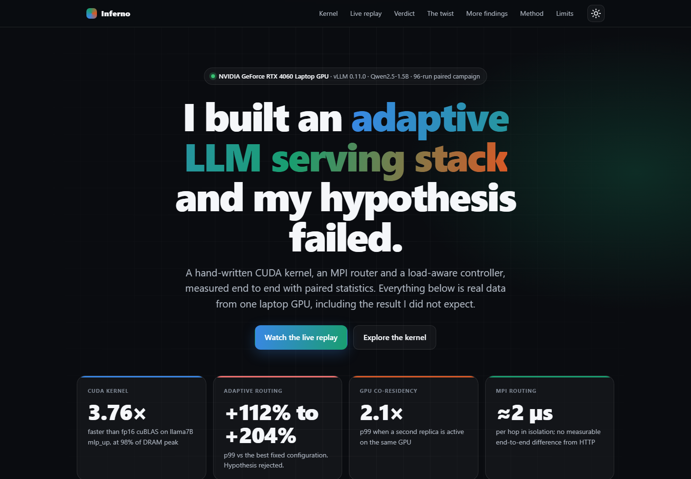
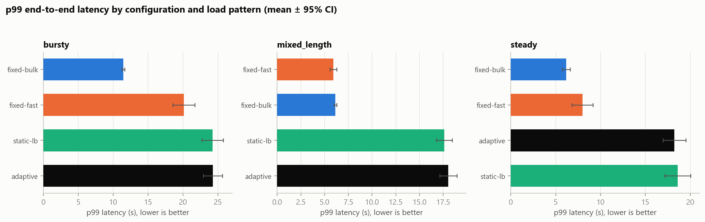
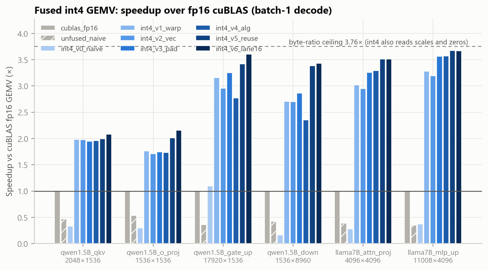
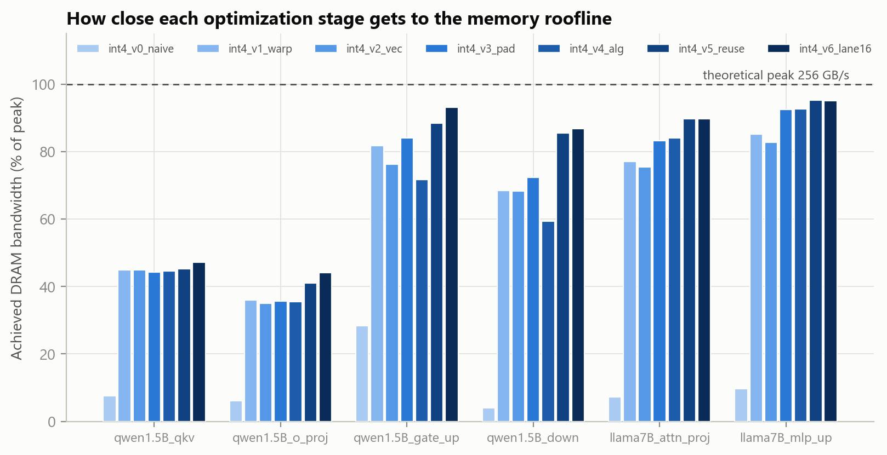
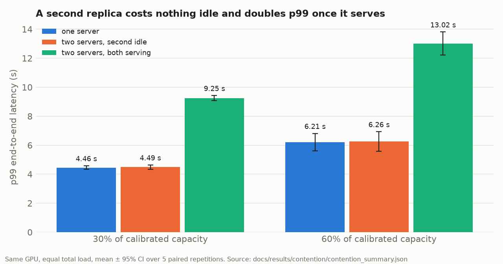

# Inferno: adaptive LLM inference serving, measured end to end

Inferno is an experimental testbed for one systems question: **can an adaptive serving policy beat every fixed
configuration under realistic, bursty LLM traffic, and where does the win come from?** It covers the whole
stack: a hand-written CUDA kernel, an MPI request router, a load-aware routing controller, cloud deployment,
and a statistics pipeline that tells you when the result is *not* significant.

Every headline number in this repo is produced by a script from raw per-request logs. Nothing is hand-entered.
Where a hypothesis fails, the report says so.

[](docs/demo/index.html)

Open [`docs/demo/index.html`](docs/demo/index.html) in a browser (or host it on GitHub Pages) for the interactive version.

<!-- FINDINGS:START -->
**Headline findings** (details in [`docs/FINDINGS.md`](docs/FINDINGS.md); every number is generated from data):

- **Kernel:** a hand-written fused int4 GEMV reaches 95% of theoretical DRAM bandwidth (97% of the measured streaming-read bandwidth) and 3.67x fp16 cuBLAS on `llama7B_mlp_up` (byte-ratio ceiling 3.76x). Inside vLLM (CUDA graphs, one sequence) it decodes at 144 tok/s vs 143 for the default Marlin path (67 for fp16), and Marlin is faster with 4+ concurrent sequences. It does not beat vLLM's Marlin kernel at batch 1 (an earlier claim that it did was a measurement error, since corrected).
- **Adaptive routing (H1) was rejected:** p99 +112% to +204% versus the best fixed configuration, 8 paired repetitions, Holm-corrected.
- **Why:** a second *active* replica on the same GPU multiplies p99 by 2.1x; an idle resident one costs nothing (60% load: 6.21 s one server, 6.26 s with an idle second replica, 13.02 s with both serving; 5 paired reps). Replicas need separate devices.
- **Kernel vs vLLM's Marlin, every Qwen layer, batch 1-64:** the custom kernel wins only on qkv/o_proj at batch 1 (15% of decode GEMM time), ties the large layers, and is 2-7x slower from batch 4. Decision: keep Marlin; effort moves to routing.
- **Correctness finding (unconfirmed elsewhere):** on this machine vLLM 0.11's Marlin int4 GEMM gave intermittent errors up to 28% at batches [32, 64, 128], correct at [1, 8, 16, 48]; caught by the benchmark's reference check ([report](docs/results/marlin_fault/report.md)).
- **Quantization (same offered load):** int4 vs fp16 cuts p50 latency 2.1x and lifts tokens/joule +12%; reconfiguring a server costs ~48 s, so adaptivity has to route across pre-loaded replicas.
- **MPI routing:** ~2 us per hop in isolation, no measurable end-to-end difference from an HTTP router.
<!-- FINDINGS:END -->

<!-- RESULTS:START -->
Measured on `campaign` (mean ± 95% CI, paired by repetition). Raw data and code: this repo.

| Load pattern | Best fixed baseline | Adaptive p99 change | Holm p | Throughput vs best fixed | Verdict |
|---|---|---|---|---|---|
| bursty | fixed-bulk | +112.3% | 0.0234 | 0.94x | adaptive WORSE: p99 +112.3% (Holm p=0.0234) |
| mixed_length | fixed-fast | +204.3% | 0.0234 | 0.96x | adaptive WORSE: p99 +204.3% (Holm p=0.0234) |
| steady | fixed-bulk | +195.3% | 0.0234 | 0.94x | adaptive WORSE: p99 +195.3% (Holm p=0.0234) |



**CUDA kernel** on NVIDIA GeForce RTX 4060 Laptop GPU (theoretical DRAM peak 256 GB/s; all kernels match the CPU reference):




<!-- RESULTS:END -->

## What is in here

| Layer | What it does | Where |
|---|---|---|
| **Fused int4 CUDA kernel** | Dequantize + GEMV in one pass, seven-stage optimization ladder (v0..v6), small-batch sweep, benchmarked against cuBLAS fp16 and an unfused pipeline, correctness-checked against a CPU reference, run-to-run spread reported; patched into vLLM as a torch custom op and compared end to end with Marlin (parity at one sequence); Nsight scripts included (need GPU counters enabled) | `src/inferno/kernels/` |
| **MPI router** | Rank-0 dispatcher + replica workers (`isend`/`iprobe`), per-hop overhead timestamps, GPU-free coordination microbenchmarks, HTTP-router baseline | `src/inferno/mpi_router/` |
| **Adaptive controller** | Interpretable three-level policy with hysteresis over a pool of pre-loaded heterogeneous replicas (load- and prompt-length-aware), compared against every fixed baseline inside the same pool | `src/inferno/controller/` |
| **Measurement harness** | Open-loop Poisson/bursty/bimodal load, TTFT / TPOT / p50-p99, goodput under an SLO, GPU power and tokens per joule, self-describing `hardware.json` | `src/inferno/serving/`, `metrics.py`, `power.py` |
| **Statistics** | Mean ± 95% CI, paired tests across identical seeded request streams, Holm correction, effect sizes, plain-language verdicts including null and negative results | `src/inferno/analysis/` |
| **Cloud phase** | Terraform + orchestration for a multi-GPU instance with a hard self-terminate cost cap | `infra/aws/`, `scripts/launch_cloud.sh` |
| **Showcase site** | One self-contained page (no CDNs): interactive kernel race, live replay of recorded runs, verdict cards, contention explainer, dark/light. Rebuilt from data by `make site` | `demo/`, `docs/demo/index.html` |

## Hypotheses and outcomes

<!-- OUTCOMES:START -->
| ID | Statement | Outcome (generated from data) |
|---|---|---|
| H1 | The adaptive router achieves lower p99 than the best fixed configuration at non-inferior throughput under bursty / mixed-length load | **Rejected** on this hardware: p99 bursty +112%, mixed_length +204%, steady +195% (paired, Holm-corrected). Mechanism isolated; untested with one replica per GPU. |
| H2 | MPI-coordinated multi-replica routing scales sub-linearly; coordination overhead is measured | **Sub-linear: yes** (2 replicas on one GPU: efficiency 0.47, throughput 2106 to 1980 tok/s). **Overhead:** ~2 us/hop isolated, ~2.0 ms in situ, MPI vs HTTP throughput +0.58%, +0.01%; no crossover observed. |
| H3 | A hand-written fused int4 kernel reaches a fraction of the vendor path; the gap is explained by profiler counters | **Refuted as stated, explanation pending:** the kernel reaches 95% of DRAM peak and 3.67x fp16 cuBLAS on llama7B_mlp_up; in situ it is close to, but not faster than, vLLM's Marlin kernel at batch 1, and slower at concurrency (layer matrix: wins only qkv/o_proj at batch 1). Counter-level explanation is pending (GPU counters blocked, `docs/PROFILING.md`). |
| H4 | Systems-level adaptivity, not model changes, drives efficiency gains (tokens per joule) | **Not supported locally:** adaptive tokens/joule vs the best fixed config: bursty -10.0%, mixed_length -6.3%, steady -7.9%. |
<!-- OUTCOMES:END -->

Each hypothesis has a stated boundary condition (see `docs/methodology.md`), and the report code states null and
negative outcomes as plainly as wins.

## Design decisions worth knowing

- **Adaptivity means routing, not hot-swapping.** vLLM cannot change batch size or quantization on a live server;
  that needs a reload (the harness measures its cost). The controller therefore chooses *which pre-loaded
  configuration serves each request*.
- **Fair baselines.** Every fixed policy runs inside the same pool with the same GPU memory residency, so the
  adaptive policy cannot win by giving the baseline a different hardware situation.
- **Open-loop load.** Requests are sent at scheduled times regardless of completions, and latency is measured
  from the scheduled arrival, so queueing delay is included rather than hidden.
- **Paired design.** Repetition *k* of every policy replays the identical seeded stream; policy order within a
  repetition is shuffled to cancel thermal drift on a laptop GPU.
- **Kernel benchmarking discipline.** Weights rotate through 24x the L2 size (768 MB) so every launch streams from
  DRAM; without this, cache hits inflate bandwidth (6x L2 was tried first and leaked ~6%, which was found and corrected).
  Library kernels are timed in situ in CUDA-graph decode and end to end, not only in isolation.

## Verify it in two commands

```bash
make figure        # rebuilds the headline figure from saved data (docs/results), no GPU needed
make quick-bench   # ~3-5 min GPU run: hardware record + kernel/Marlin/AWQ timings + Marlin correctness probe
```



Reproducing on your own machine? Follow [`docs/REPRODUCE.md`](docs/REPRODUCE.md) and send back the files it lists.

## Quick start

Linux or WSL2 (vLLM does not run on native Windows).

```bash
bash scripts/setup_env.sh          # uv + Python 3.12 venv (resolution date-pinned for CUDA 12.x drivers)
bash scripts/setup_toolchain.sh    # no-root nvcc, gcc, Nsight Compute, OpenMPI, mpi4py
source scripts/toolchain_env.sh

make test                          # unit tests (no GPU needed)
make plan                          # what each experiment would run, and how long it takes
make smoke                         # ~10 min end-to-end check on one config
make kernel                        # build + run the CUDA kernel benchmark
make layer-matrix                  # every Qwen layer x batch 1..64: custom vs Marlin vs AWQ vs fp16
make marlin-probe                  # Marlin batch-size correctness probe
make calibrate                     # measure capacity, derive load rates from it
make baseline | sweep | scaling | contention | campaign
make report RUN=results/<run>      # tables + figures from a finished run
```

Hardware note: developed on an RTX 4060 Laptop GPU (8 GB), so the local study uses Qwen2.5-1.5B-Instruct
(official fp16 / GPTQ-Int8 / AWQ-Int4 releases). The cloud configs re-run on a 7B model across multiple GPUs.

## Repository layout

```
configs/         model, workload, pool, experiment YAML (local + cloud variants)
src/inferno/
  kernels/       int4_gemv.cuh, bench_int4_gemv.cu, Makefile (nvcc + Nsight)
  mpi_router/    dispatcher, workers, routing policy, microbenchmarks
  controller/    routing policies, live closed-loop router
  serving/       vLLM server manager, open-loop client, replica pool
  experiments/   baseline, sweep, scaling, adaptive/campaign, report
  analysis/      aggregation, statistics, figures
demo/            showcase site builder (template + data assembly); output in docs/demo/
infra/aws/       Terraform for the multi-GPU cloud phase
docs/            methodology, roadmap, kernel report, posting guide
tests/           unit tests (GPU-free ones run in CI)
```

## Limitations (stated up front)

- The local GPU is small and shared by all replicas, so multi-replica results reflect memory-bandwidth
  contention, not independent devices; the cloud phase addresses this.
- Prompts are synthetic filler with server-verified token counts; quality (accuracy) of quantized models is not
  evaluated here, so "faster" always means "at the published checkpoint quality".
- The hand-written kernel targets batch-1 decode. It is not a replacement for production kernels at larger
  batch sizes.

## License

MIT
